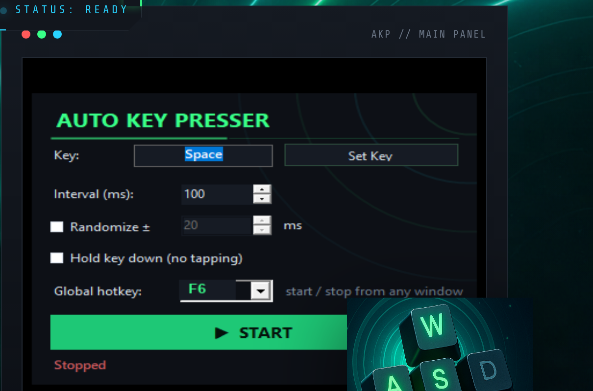

# Key Repeater Utility — Hold or Tap Any Keyboard Key on Windows

A small Windows tool that taps or holds any keyboard key for you at a chosen pace, toggled with one global hotkey. Built for AFK farming in idle and incremental games, UI testing loops, long data-entry sessions, keep-awake duty during a download, and anything else where a human finger would otherwise be stuck pressing the same button for an hour. Portable build for Windows 10 and 11, free, no account, no ads, no watermark.

The point of a trustworthy **auto key presser** is a steady, predictable rhythm you can walk away from. Pick a key, dial the interval, press the hotkey, come back later.

## Download

**Latest build:** [KeyRepeaterUtility.zip](../../releases/latest/download/AutoKeyPresser.zip)

The archive is self-contained. Unzip anywhere — Documents, Desktop, a USB stick — and launch the app from the folder. No installer, no admin prompt.

## Features

- **Any key on the keyboard** — letters, digits, Space, Enter, arrows, F-keys, numeric pad. Click **Set Key**, press the key, done.
- **Interval from 5 ms to 10 minutes** — fast enough for a rapid tap in an idle game, slow enough for an anti-idle heartbeat during a long upload.
- **Tap or Hold** — fire quick repeated presses, or keep the key held down continuously as if the physical key were stuck.
- **Random ± jitter** — add a small offset to each interval so the pattern does not read as a metronome.
- **Global hotkey** — F6 by default, rebindable to any F1–F12. Starts and stops from any window, including full-screen games, remote desktops and minimized apps.
- **SendInput + hardware scan codes** — input lands in games and remote sessions that quietly drop keystrokes from older tools.
- **Session counter** — see how many presses have fired since the last Start, useful when you want to stop at a round number.
- **Dark single-window UI** — one small window, no tabs, no settings tree.
- **Zero background services** — close the window, the process ends. Nothing stays in the tray.

## How to use

1. Open the folder, launch the app.
2. Click **Set Key** and press the key you want repeated.
3. Enter the interval in milliseconds, or tick **Hold key down** for continuous pressure.
4. Optional: tick **Randomize ±** and set a jitter window.
5. Hit **Start**, or press **F6** from any other window to toggle.

The hotkey works even if the app is minimized or hidden behind a full-screen game.

## FAQ

**Is it really free?**
Yes. Free forever, no trial, no locked buttons, no Pro tier. MIT licensed.

**Does it need an account?**
No. Nothing to sign up for, nothing to log into.

**Does it run on Windows 11?**
Yes. Windows 10 and Windows 11, 64-bit. Behaviour is identical between the two.

**Does it need to be installed?**
No. Portable build — unzip, run, done. To remove it, delete the folder.

**Is it safe?**
Yes. The app sends standard keyboard events through the operating system — exactly what a physical keyboard would send. It does not read other processes, does not hook game clients, does not touch files outside its own folder.

**Does it show ads?**
No. No ads, no bundled offers, no telemetry, no background updater.

## System requirements

- Windows 10 or Windows 11, 64-bit
- A keyboard

## A note on fair use

An **auto key presser** is designed for single-player games, idle/incremental titles, accessibility, keep-awake and routine testing. Online titles with kernel-level anti-cheat may forbid any form of input automation — the app makes no attempt to hide what it is doing, so use it responsibly inside each game's terms of service.

## License

MIT.
